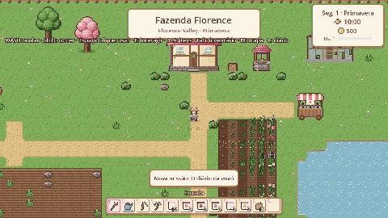

# 🌸 Florence Valley

*Plant dreams, grow happiness.*

Florence Valley is a cozy farming, gardening and country-life simulation in 2D top-down pixel art, built with **Godot 4** and **GDScript**. You inherit your grandmother's old property. She was a renowned flower grower in the valley, and the farm needs restoring.

> **Version 1.0.0.** All 9 roadmap phases are done: 17 flowers to grow, a flower shop, 6 villagers with a story, 14 maps, building, progression, original music, seasons and builds for macOS and Windows.



🎬 [Trailer (MP4, 27 s)](docs/video/trailer.mp4)

## Download and play

Build with `tools/export_builds.sh /Applications/Godot.app/Contents/MacOS/Godot` (output in `builds/`), or download from the repository's *Releases* page once published.

- **macOS** (Apple Silicon and Intel): unzip `FlorenceValley.zip` and open `Florence Valley.app`. The app is not signed by Apple, so the first time right-click → **Open**.
- **Windows** (64-bit): run `FlorenceValley.exe`. SmartScreen may warn that it is unsigned: **More info → Run anyway**.

## Running

1. Install **Godot 4.7** (standard build, not .NET). On macOS: `brew install --cask godot`.
2. Open Godot, click **Import**, select `project.godot`.
3. Press **F5**.

```bash
/Applications/Godot.app/Contents/MacOS/Godot --path .
```

**Controls:** WASD/arrows to walk (8 directions), hold Shift to run. Space/J/left click uses the selected item, E/right click interacts (harvest, sleep at the house door, refill at the well). Keys 1–9, 0, -, = or the mouse wheel select items, Tab/I opens the inventory, M opens the valley map and Esc pauses. A gamepad is supported.

## Tests

```bash
tools/run_tests.sh /Applications/Godot.app/Contents/MacOS/Godot
```

This runs 236 unit and integration tests with a dependency-free runner. The integration tests load the real farm scene and drive the player with simulated input.

## Art and sound

All pixel art is original and generated deterministically by `tools/generate_assets.gd` (regenerate with `tools/build_assets.sh`). The music (one track per season plus the title theme) and sound effects are original too, synthesised by `tools/generate_music.gd` and `tools/generate_audio.gd`. At night, lamps and windows light up; autumn turns the trees amber and winter brings snow. The game text is localized through `data/localization/strings.csv`: Brazilian Portuguese is the default, and English is included.

See [docs/ARCHITECTURE.md](docs/ARCHITECTURE.md) and [docs/ROADMAP.md](docs/ROADMAP.md). The docs are written in Portuguese.

## License

MIT, see [LICENSE](LICENSE).
